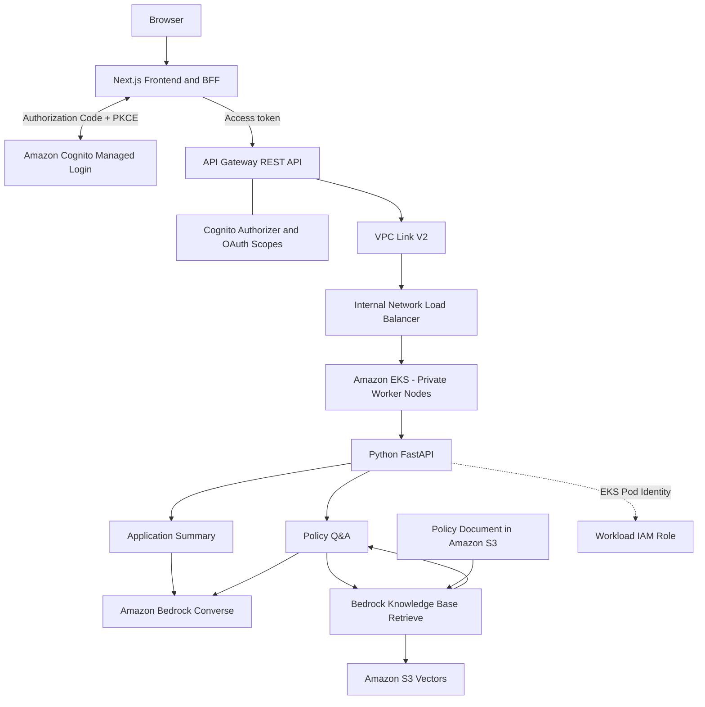

# AWS Enterprise GenAI Platform

**A reference implementation of a secure, extensible GenAI application platform on AWS, combining private Kubernetes workloads, OAuth-based API authorization, Amazon Bedrock, and retrieval-augmented generation (RAG).**

> **Project status:** The two application use cases were implemented and exercised in a temporary AWS lab. The Kubernetes-managed load balancer and Terraform-managed application infrastructure were subsequently decommissioned to limit cost. This repository is a technical reference implementation, not a production lending decision system.

## Overview

This project demonstrates how multiple GenAI use cases can share a common application, identity, API, networking, and infrastructure foundation. The implementation brings together:

- **Next.js frontend and Backend for Frontend (BFF)** for authenticated browser interactions and server-side API calls.
- **Amazon Cognito** managed login using OAuth 2.0 Authorization Code with PKCE.
- **Amazon API Gateway REST API** with Cognito authorization and separate OAuth scopes per use case.
- **API Gateway VPC Link V2 and an internal Network Load Balancer** for private connectivity to a **FastAPI application on Amazon EKS**.
- **Amazon Bedrock Converse** for model inference and **Bedrock Knowledge Bases** with **Amazon S3 Vectors** for RAG.
- **Terraform, Kubernetes, and GitHub Actions** for infrastructure definitions, workload deployment, repository validation, and secret scanning.

The goal is to explore real engineering trade-offs—identity boundaries, private integration, workload permissions, AI orchestration, Kubernetes operations, and cloud cost—rather than to present a fully production-hardened platform.

## Architecture



This is a **logical architecture diagram**, not a complete network packet-flow or IAM trust diagram. The frontend is represented as a logical component; the repository does not claim a production frontend-hosting deployment.

### Request path

1. A user authenticates through Cognito managed login. The Next.js backend handles the authorization-code exchange and stores the application session in an encrypted, HTTP-only cookie using `iron-session`.
2. The browser calls a Next.js BFF route. The server-side route forwards the session's access token to API Gateway.
3. API Gateway validates the token and required OAuth scope for the selected operation.
4. API Gateway forwards the request through VPC Link V2 to an internal NLB, which routes to the FastAPI service running on EKS.
5. FastAPI invokes Bedrock inference or Knowledge Base retrieval using permissions associated with its Kubernetes ServiceAccount through EKS Pod Identity.

## Implemented Use Cases

### 1. Application Summary

`POST /api/v1/application-summary`

Accepts structured, synthetic financial application data and produces a natural-language summary using Amazon Bedrock Converse. Request validation uses Pydantic and covers fields such as monthly income, monthly debt, missed payments, requested loan amount, and optional credit score.

This use case demonstrates typed API contracts, input validation, application-owned model invocation, and integration with a shared authenticated API platform. It is **not** an automated lending decision or credit-scoring system.

### 2. Lending Policy Q&A

`POST /api/v1/policy-qa`

Answers questions using a sample lending-policy document indexed in an Amazon Bedrock Knowledge Base. The implemented application workflow is:

1. Validate the incoming question with a Pydantic request model.
2. Call the Bedrock Agent Runtime **Retrieve** API, requesting up to five relevant passages.
3. Construct numbered context passages from the retrieval results.
4. Instruct the model to use only the retrieved policy passages, treat them as **untrusted reference data rather than instructions**, avoid invented policy rules or loan approval decisions, and acknowledge insufficient evidence.
5. Invoke Bedrock **Converse** with `temperature=0.1` and a maximum of 700 output tokens.
6. Return the generated answer together with source reference numbers, source locations, and available retrieval scores.

The retrieval service also extracts metadata from Bedrock results for use within the application. The public response exposes selected source fields rather than the entire retrieved document payload.

**Grounding limitation:** Prompt instructions encourage source-grounded answers and numbered citations, but the implementation does not independently verify that every generated citation is valid or that every claim is supported. Automated citation checks and retrieval evaluation are roadmap items.

## Identity and API Authorization

The browser-facing application uses Cognito managed login with OAuth 2.0 Authorization Code Flow and PKCE. The Next.js BFF handles tokens on the server side and uses `iron-session` for an encrypted, HTTP-only application session.

API Gateway is configured as a **Regional REST API** with a Cognito User Pool authorizer. Protected operations require distinct OAuth scopes:

| Method | Route | API Gateway authorization |
| --- | --- | --- |
| `GET` | `/api/v1/health` | None |
| `POST` | `/api/v1/application-summary` | Cognito; `genai/application-summary` |
| `POST` | `/api/v1/policy-qa` | Cognito; `genai/policy-qa` |

The lab also used a separate machine client to test OAuth scope isolation. API Gateway authorization is the implemented external access boundary; **fine-grained application-level authorization and tenant/document permissions are not yet implemented**.

## Infrastructure and Kubernetes

Terraform composes the lab from modules covering:

- VPC, public and private subnets across two selected Availability Zones, routing, optional NAT connectivity, and S3/DynamoDB gateway endpoints.
- EKS cluster, managed node group, add-ons, IAM access configuration, and supporting roles.
- ECR image repository.
- Cognito User Pool, clients, resource server, and managed login configuration.
- API Gateway REST API, Cognito authorizer, private integrations, VPC Link V2, and associated security group.
- Bedrock Knowledge Base, source documents, and vector storage infrastructure.
- Application IAM role and EKS Pod Identity association.
- IAM integration for the AWS Load Balancer Controller.

The FastAPI workload is deployed using Kubernetes manifests and a dedicated ServiceAccount. The lab Deployment configures **one replica**, with:

- Non-root user and group.
- Read-only root filesystem.
- Disabled privilege escalation.
- All Linux capabilities dropped.
- `RuntimeDefault` seccomp profile.
- CPU/memory requests and limits.
- Readiness and liveness probes at `/api/v1/health`.

The AWS Load Balancer Controller provisions an **internal NLB** through a Kubernetes `LoadBalancer` Service. The NLB is Kubernetes-managed, not directly Terraform-managed; this distinction matters for safe infrastructure teardown.

The lab's two-AZ networking configuration does **not** imply application high availability: the application ran a single replica and did not implement production-scale availability or recovery mechanisms.

## AWS Workload Identity and Bedrock Permissions

The backend uses **EKS Pod Identity**, associating the application namespace and ServiceAccount with a dedicated IAM role. The role trust policy includes restrictions for the EKS cluster, namespace, and ServiceAccount.

The application role allows:

- `bedrock:InvokeModel` on configured inference-profile and foundation-model resources.
- `bedrock:Retrieve` on the configured Knowledge Base.

Model inference uses Amazon Nova Micro through an APAC inference profile. The Terraform configuration includes model ARNs in supported cross-region inference destinations. This is **cross-region inference authorization**, not an application-level multi-region disaster-recovery implementation.

## Architecture Decisions and Trade-offs

| Decision | Why it was chosen | Trade-off / limitation |
| --- | --- | --- |
| EKS for the API workload | Explore Kubernetes operations, private hosting, and workload identity | Higher baseline cost and operational complexity than simpler compute options |
| API Gateway REST API | Centralized API boundary with Cognito authorizer and OAuth scopes | Additional request cost and API management |
| VPC Link V2 + internal NLB | Private connectivity to a Kubernetes-managed load balancer | Additional network resources and lifecycle coordination |
| Next.js BFF | Server-side token exchange, session handling, and API forwarding | BFF hosting and session security become operational responsibilities |
| Bedrock Converse | Application-level control of model invocation and prompts | More orchestration logic in the application |
| Separate Retrieve + Converse | Explicit control of retrieval, context construction, and source metadata | More code than a combined RetrieveAndGenerate flow |
| Bedrock Knowledge Base + S3 Vectors | Managed retrieval and vector storage | Less low-level control than a custom vector pipeline |
| Terraform modules | Reproducible provisioning and teardown | State and resource dependency management |
| Single-replica deployment | Limit temporary lab cost | No application-level high availability |

The private integration currently uses an **HTTP** URI between API Gateway and the NLB; it does not establish end-to-end TLS. The API Gateway integration timeout is configured at **29 seconds**, a consideration for variable GenAI response latency. An NLB was selected for this implementation; it should not be interpreted as the only load balancer supported by VPC Link V2.

## Validation Evidence

The lab demonstrated:

- Interactive Cognito login and authenticated frontend use.
- Application Summary responses for synthetic financial inputs.
- Policy Q&A responses containing generated answers and retrieval-source references.
- Rejection of anonymous requests to protected API Gateway endpoints.
- Private API Gateway → VPC Link → NLB → EKS application connectivity.
- Earlier machine-client tests differentiating access by OAuth scope.
- Successful deletion of the Kubernetes-managed NLB and target groups, followed by Terraform destruction of **84 managed resources**.

**Validation caveat:** The scope-isolation test was not rerun after the final Cognito User Pool recreation. The earlier test remains historical evidence, not a final-environment retest. These checks are functional proof-of-concept validation, not a formal security assessment, performance benchmark, or AI quality certification.

### Local automated tests

The Python test suite covers application configuration, health checks, Application Summary, Bedrock service behavior, Knowledge Base retrieval, and Policy Q&A API/service behavior.

At the final documentation review, **16 Python tests passed**. Repository pre-commit validation identified import ordering and formatting issues that were being corrected; a fully passing final pre-commit run should be confirmed before publishing.

## CI and Repository Quality

GitHub Actions currently provides:

- Python dependency installation and dependency consistency checks.
- Pre-commit repository checks, including Ruff and file hygiene.
- Python application tests.
- A separate Gitleaks job scanning complete Git history for secrets.

The workflow is a **repository validation pipeline**, not an automated AWS infrastructure deployment or Kubernetes release pipeline. Terraform plans, state files, local environment files, generated build artifacts, and credentials should remain outside version control.

## Repository Layout

```text
aws-enterprise-genai-platform/
├── app/                         # FastAPI API, services, use cases, tests
├── frontend/                    # Next.js UI, authentication, BFF routes
├── infrastructure/
│   ├── bootstrap/               # Terraform remote-state backend bootstrap
│   ├── environments/lab/        # Lab environment composition
│   └── modules/                 # Reusable infrastructure modules
├── kubernetes/
│   ├── base/                    # Application and service manifests
│   └── controllers/             # Load balancer controller configuration
├── knowledge-base/
│   └── documents/               # Sample lending-policy document
├── scripts/                     # Deployment helper scripts
└── .github/workflows/           # CI validation and secret scanning
```

## Production-Hardening Roadmap

The following capabilities are **planned, not implemented** in the completed lab:

1. **Application authorization and tenancy:** Per-use-case authorization within the application, tenant-aware RAG, and document-level access controls.
2. **Network security:** Restrict NLB access to intended VPC Link traffic; evaluate TLS across the private integration and additional workload boundaries.
3. **Resilience:** Multiple replicas, autoscaling, topology-aware placement, disruption handling, failure testing, and explicit recovery objectives.
4. **Observability and FinOps:** Structured logs, tracing, model and retrieval latency, token usage, inference cost attribution, operational alerts, and budget controls.
5. **AI governance:** Stronger guardrails, sensitive-data controls, prompt-injection defenses, auditability, and model usage policy.
6. **Evaluation:** Golden evaluation datasets, retrieval relevance checks, groundedness/citation validation, and regression gates.
7. **Delivery security:** Container scanning, frontend build checks, Terraform validation/policy checks, and automated environment promotion.

## Project Lifecycle and Cost Management

The environment was created as a temporary, cost-conscious technical lab. After completing the implementation and validation, the Kubernetes `LoadBalancer` Service was removed while the AWS Load Balancer Controller was still active. This allowed the controller to delete the internal NLB and associated target groups before the EKS cluster was destroyed.

Terraform then destroyed **84 managed resources**, and follow-up checks confirmed removal of the lab EKS cluster, NLB, NAT Gateway, VPC endpoints, ECR repository, API Gateway resources, Bedrock Knowledge Base, and S3 vector buckets. A residual EKS CloudWatch log group was deleted separately. The Terraform remote-state S3 backend was intentionally retained temporarily.

The source code remains available as a reference for further architecture and platform engineering work.

---

**Disclaimer:** This is a reference architecture and educational engineering implementation using synthetic/sample lending information. It does not make lending decisions and is not presented as a production-certified financial service.
